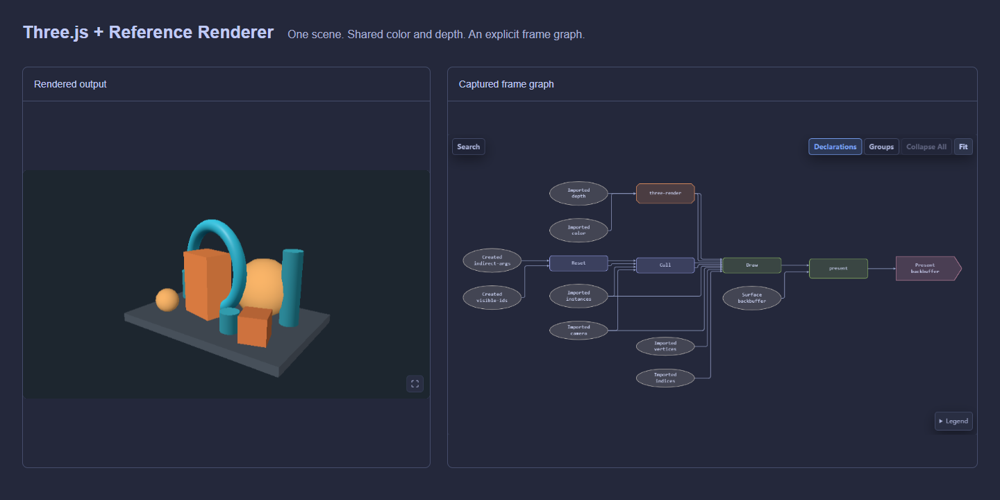

<!-- translation: {"version":1,"source":"README.md","sourceHash":"a0ab9c13cc588aea8a0916cd82a14831157c40b5c00a0b5b6422b8234f262b13","state":"ready"} -->

<!-- readme-hero:start -->

   
  <a href="https://uinosoft.github.io/zenfg/">
    <picture>
      <source media="(prefers-color-scheme: dark)" srcset="assets/brand/zenfg-lockup-dark.svg">
      <source media="(prefers-color-scheme: light)" srcset="assets/brand/zenfg-lockup-light.svg">
      
    </picture>
  </a>
   

  <strong>面向 WebGPU 与 wgpu 的可组合 FrameGraph。</strong>

<!-- generated:badges:start -->

<!-- generated:badges:end -->

  <a href="https://uinosoft.github.io/zenfg/">官网</a> ·
  <a href="https://uinosoft.github.io/zenfg/docs/zh-CN/">文档</a> ·
  <a href="https://uinosoft.github.io/zenfg/playground/">示例</a> ·
  <a href="https://uinosoft.github.io/zenfg/inspector/">Inspector</a>

  <a href="README.md" lang="en">English</a> · <strong lang="zh-CN">简体中文</strong>

<!-- readme-hero:end -->

# ZenFG

**自主构建渲染功能，组合不同 GPU 系统，看清每一帧的执行过程。**

ZenFG 通过显式 FrameGraph 协调渲染与计算工作。直接使用 WebGPU 或 wgpu
开发领域功能，或接入已有引擎，再把它们组合到同一帧中。
场景、材质、管线和渲染策略由你掌控；ZenFG 负责声明的依赖、执行顺序、
瞬态资源生命周期与诊断。TypeScript 与 Rust 运行时共享语义和可移植 Snapshot，
并提供可嵌入的 Inspector。

## 为什么选择 ZenFG

- **自主实现** — 使用原生 GPU API 或兼容的第三方库构建功能，保留自己的渲染架构。
- **组合已有成果** — 将外部引擎和图内渲染、计算模块组合使用，显式声明共享资源与执行边界。
- **看清实际流程** — 用 Inspector 检查帧图、资源和可选 CPU/GPU 计时；导出 Snapshot，结合代码进行人工或 AI 辅助分析，再次捕获以验证修改。
- **协调依赖与资源** — 保留必要工作、裁剪未使用的工作，管理瞬态资源的分配、生命周期、别名复用与资源池。

<!-- readme-showcase:start -->

  

<!-- readme-showcase:end -->

[Three.js 协同渲染](https://uinosoft.github.io/zenfg/playground/?example=three-interop&panel=inspector)：两个渲染器共享颜色与深度附件，在同一场景中互相遮挡。

也可以查看 [Reference Renderer](https://uinosoft.github.io/zenfg/playground/?example=reference-renderer&panel=inspector) 的 GPU 裁剪与间接绘制、
[PlayCanvas 流式 GSplat](https://uinosoft.github.io/zenfg/playground/?example=playcanvas-gsplat-streaming-interop&panel=inspector)（需要网络）和
[TypeGPU Slime Mold](https://uinosoft.github.io/zenfg/playground/?example=typegpu-slime-mold&panel=inspector) 的计算与渲染节点。
各示例的源码与说明记录了依赖版本和接入细节。

## 从这里开始

- **WebGPU / TypeScript** — 从
  [`@zenfg/webgpu` 快速入门](packages/webgpu/README.zh-CN.md#quick-start)开始，
  再查看[完整 TypeScript 示例](packages/webgpu/examples/README.zh-CN.md)。
- **wgpu / Rust** — 阅读
  [`zenfg` 快速入门](crates/zenfg/README.zh-CN.md#quick-start)和
  [Cargo 示例](crates/zenfg/examples/)。
- **在线体验** — 浏览[实时示例](https://uinosoft.github.io/zenfg/playground/?example=interactive-background&panel=inspector)、
  对应的 TypeScript 源码与 Inspector 捕获结果，或在
  [Inspector](https://uinosoft.github.io/zenfg/inspector/) 中打开 Snapshot。
  Inspector 完全在浏览器中运行，不会上传导入的快照。

更多指南和参考资料见[文档索引](docs/README.zh-CN.md)。
修改公共语义、示例或发布产物前，请阅读英文[贡献指南](CONTRIBUTING.md)。
源码开发使用 pnpm 管理 JavaScript、Cargo 管理 Rust；在仓库根目录运行
`pnpm install --frozen-lockfile` 安装工作区依赖。

## 集成层级

应用负责设备、渲染策略和呈现；ZenFG 协调图中声明的工作。具体录制、资源、执行与集成契约见各包指南：

- [WebGPU 使用指南](packages/webgpu/docs/README.zh-CN.md)
- [Rust 使用指南](crates/zenfg/docs/README.zh-CN.md)

## 发布包

<!-- generated:packages:start -->
| 包 | 用途 | 发布版本 | 文档 |
| --- | --- | --- | --- |
| [`@zenfg/webgpu`](packages/webgpu/README.zh-CN.md) | TypeScript/WebGPU FrameGraph 运行时 |  | [指南](https://uinosoft.github.io/zenfg/docs/zh-CN/packages/webgpu.html) |
| [`@zenfg/snapshot`](packages/snapshot/README.zh-CN.md) | Snapshot 1.2 类型、编解码、验证与规范 |  | [指南](https://uinosoft.github.io/zenfg/docs/zh-CN/packages/snapshot.html) |
| [`@zenfg/inspector`](packages/inspector/README.zh-CN.md) | 可嵌入的 DOM Inspector |  | [指南](https://uinosoft.github.io/zenfg/docs/zh-CN/packages/inspector.html) |
| [`zenfg`](crates/zenfg/README.zh-CN.md) | Rust/wgpu FrameGraph 运行时 |  | [指南](https://uinosoft.github.io/zenfg/docs/zh-CN/packages/zenfg.html) |
| [`zenfg-snapshot`](crates/zenfg-snapshot/README.zh-CN.md) | Rust Snapshot 1.2 编解码、验证与迁移 |  | [指南](https://uinosoft.github.io/zenfg/docs/zh-CN/packages/zenfg-snapshot.html) |
<!-- generated:packages:end -->

## 方向

我们正在探索可复用的 GPU-Driven Mesh、粒子与后处理模块，让独立渲染功能更容易组合并进入实际项目。

## 项目状态

ZenFG 0.1.0 是首个非预发布版本。各包独立发版，当前已发布版本见上方注册表徽章。
1.0 前公共 API 仍可能变化；集成方应固定精确包版本，并在升级前查看
[从 0.1.0 升级的迁移说明](docs/migration-0.2.0.zh-CN.md)。

TypeScript 与 Rust 共享语义和可移植诊断，不追求源码级 API 一致。
Snapshot 数据格式使用独立于包版本的版本体系；
详情参阅[兼容矩阵](docs/compatibility.zh-CN.md)与[更新日志](CHANGELOG.zh-CN.md)。

## 许可证

ZenFG 使用 [MIT License](LICENSE)。
